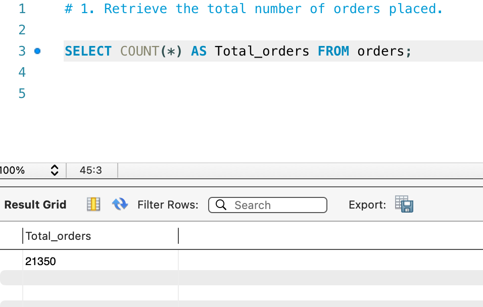
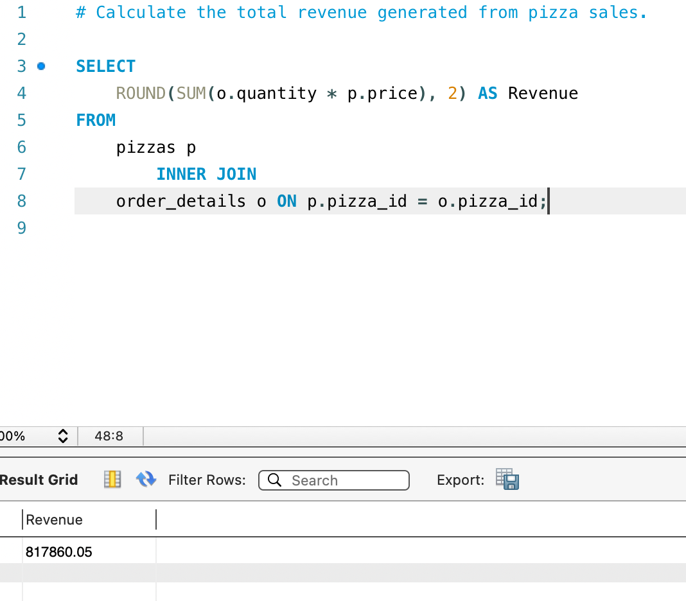
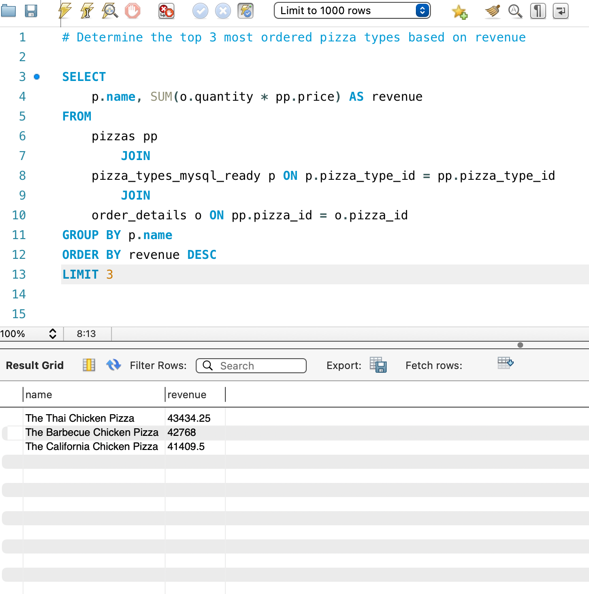
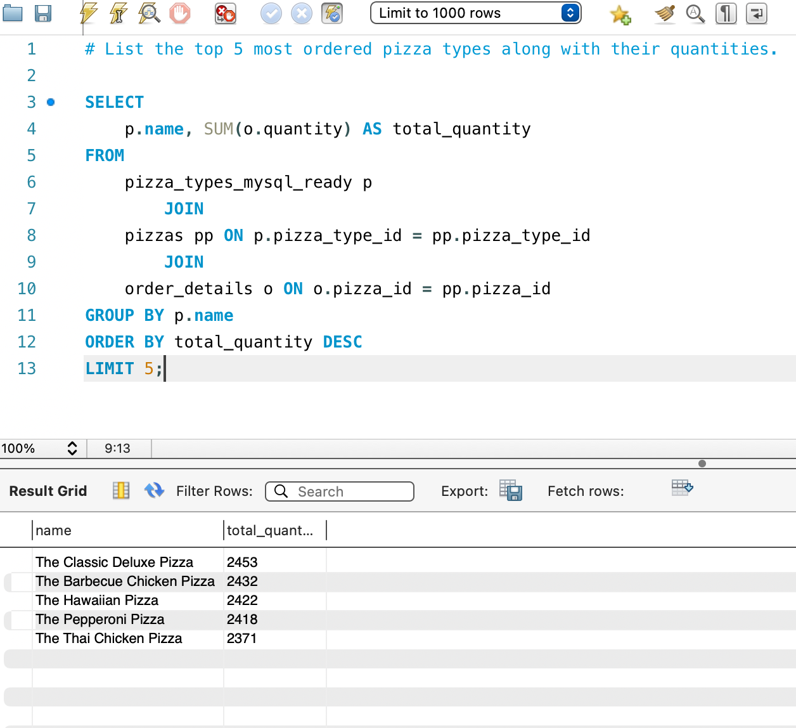
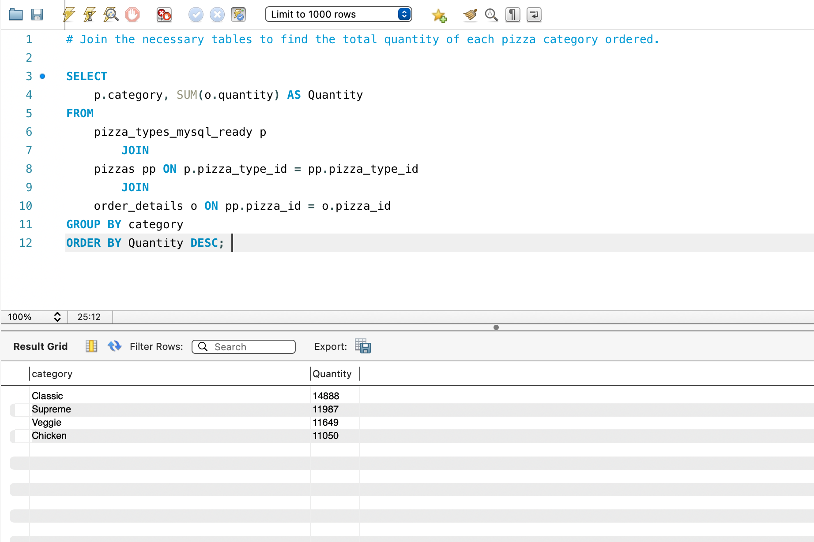

# 🍕 Pizza Sales SQL Analysis

## 📌 Project Overview

This project analyzes pizza sales data using SQL to identify sales trends, revenue performance, popular pizzas, and customer ordering patterns.

The objective is to transform raw sales data into meaningful business insights that can help a business understand its sales performance and make data-driven decisions.

## 🎯 Project Objectives

- Calculate total orders and total revenue.
- Identify the best-selling pizzas by quantity.
- Find the highest-revenue pizzas.
- Analyze sales performance across pizza categories.
- Explore order patterns and revenue distribution.
- Answer business questions using SQL queries.

## 🗂️ Dataset

The project uses four CSV files:

| File | Description |
|---|---|
| `orders.csv` | Order dates and times |
| `order_details.csv` | Order items, pizza IDs, and quantities |
| `pizzas.csv` | Pizza sizes and prices |
| `Pizza_types.csv` | Pizza names, categories, and ingredients |

These datasets were imported into MySQL for analysis.

## 🛠️ Tools & Technologies

- **MySQL**
- **MySQL Workbench**
- **SQL**
- **GitHub**

## 💻 SQL Skills Demonstrated

- SELECT statements
- Filtering and sorting
- Aggregate functions
- GROUP BY and HAVING
- Joins
- Subqueries
- Common Table Expressions (CTEs)
- Window functions
- Revenue and sales analysis

## 📊 Key Business Insights

The analysis produced the following findings:

| Business Metric | Result |
|---|---:|
| Total Orders | 21,350 |
| Total Revenue | $817,860.05 |
| Top Pizza by Quantity Sold | Classic Deluxe Pizza |
| Top Pizza by Revenue | Thai Chicken Pizza |
| Highest-Selling Category by Quantity | Classic |

### Top 5 Pizzas by Quantity Sold

| Rank | Pizza Name | Quantity Sold |
|---:|---|---:|
| 1 | Classic Deluxe Pizza | 2,453 |
| 2 | Barbecue Chicken Pizza | 2,432 |
| 3 | Hawaiian Pizza | 2,422 |
| 4 | Pepperoni Pizza | 2,418 |
| 5 | Thai Chicken Pizza | 2,371 |

### Top 3 Pizzas by Revenue

| Rank | Pizza Name | Revenue |
|---:|---|---:|
| 1 | Thai Chicken Pizza | $43,434.25 |
| 2 | Barbecue Chicken Pizza | $42,768.00 |
| 3 | California Chicken Pizza | $41,409.50 |

## 📷 Query Result Screenshots

The `screenshots` folder contains screenshots of selected SQL query results.

These demonstrate the analysis performed in MySQL Workbench.

## 📁 Project Structure

```text
pizza-sales-sql-analysis/
├── README.md
├── pizza_sales_project.sql
├── Pizza_types.csv
├── orders.csv
├── order_details.csv
├── pizzas.csv
├── .gitignore
└── screenshots/
```

## 📚 What I Learned

Through this project, I practiced writing SQL queries to analyze structured sales data, joining multiple tables, calculating business metrics, ranking products, and extracting actionable insights.

This project strengthened my SQL skills and helped me understand how data analysis can support business decision-making.

## 📸 SQL Query Results

### 1. Total Orders


### 2. Total Revenue


### 3. Top 3 Pizza Types by Revenue


### 4. Top 5 Pizza Types by Quantity Sold


### 5. Quantity of Each Pizza Category Ordered



## 👨‍💻 Author

**Ravinder Singh**

GitHub: [ravindersingh84](https://github.com/ravindersingh84)
